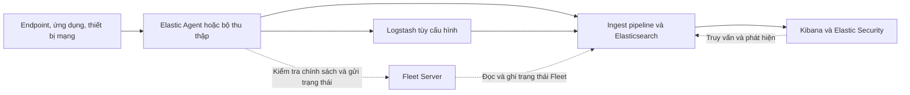
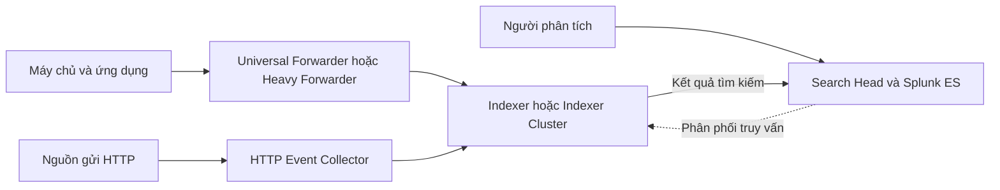
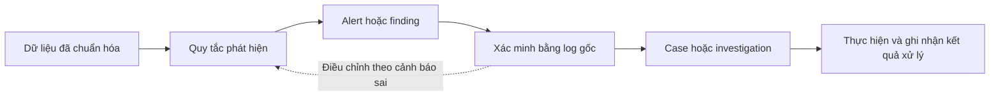

# So sánh Elastic Security và Splunk Enterprise Security

## 1. Tổng quan và phạm vi

Elastic Security và Splunk Enterprise Security (Splunk ES) đều hỗ trợ quản lý thông tin và sự kiện an ninh (Security Information and Event Management, SIEM). Trong trung tâm vận hành an ninh (SOC), hai nền tảng này tiếp nhận log từ nhiều hệ thống và đưa dữ liệu về dạng có thể tìm kiếm. Từ đó, nhóm vận hành có thể đặt quy tắc phát hiện, kiểm tra cảnh báo và lưu lại quá trình xử lý sự cố.

Elastic Security được xây dựng trên Elastic Stack. Elasticsearch lập chỉ mục, lưu trữ và tìm kiếm dữ liệu, còn Kibana cung cấp giao diện phân tích và quản lý. Elastic Agent thu thập dữ liệu và có thể được quản lý tập trung qua Fleet. Elastic Defend bổ sung khả năng bảo vệ và phản ứng trên thiết bị đầu cuối. Tổ chức có thể triển khai Elastic Stack trên hạ tầng tự quản lý hoặc sử dụng Elastic Cloud Hosted hay Elastic Cloud Serverless. [Elastic Stack][1], [Elastic Security][2]

Splunk ES là sản phẩm bảo mật chạy trên Splunk Enterprise hoặc Splunk Cloud Platform. Nền tảng Splunk đảm nhiệm thu thập, lập chỉ mục, truy vấn và hiển thị dữ liệu máy. Splunk ES bổ sung các chức năng dành cho SOC như tương quan sự kiện, phân tích rủi ro và quản lý điều tra. Các tính năng như điều phối và tự động hóa ứng phó (SOAR) hay phân tích hành vi người dùng và thực thể (UEBA) phụ thuộc vào gói và mô hình triển khai. [Cấp phép Splunk ES][7], [Gói sản phẩm Splunk][4]

Phần so sánh xét hai sản phẩm bảo mật ở cấp tính năng. Phần áp dụng vào đồ án dựa trên hệ thống Splunk Enterprise được ghi trong nhật ký triển khai, gồm một máy SIEM tập trung và các máy gửi log trong mạng mô phỏng. [Tổng quan đồ án](../../README.md), [Nhật ký triển khai SIEM](../../b-siem/deployment-log.md)

## 2. Kiến trúc hệ thống

### 2.1. Elastic Security

Trong mô hình tự quản lý dùng Fleet, Elastic Agent đọc dữ liệu theo chính sách của từng nhóm máy. Fleet Server chuyển chính sách đến agent và nhận trạng thái từ agent. Dữ liệu log đi đến đầu ra đã cấu hình, chẳng hạn Elasticsearch hoặc Logstash. Nếu dùng Logstash, hệ thống có thể xử lý thêm trước khi gửi dữ liệu sang Elasticsearch. Ở Elasticsearch, ingest pipeline có thể phân tích nội dung log, đổi kiểu trường và bổ sung thông tin trước khi lập chỉ mục. [Elastic Stack][1], [Fleet và Elastic Agent][8]

*Hình 1. Luồng thu thập và quản lý agent trong một kiến trúc Elastic tự quản lý.*

Dữ liệu theo thời gian từ các tích hợp thường được lưu trong *data stream*. Mỗi data stream dùng các chỉ mục phía sau để lưu dữ liệu và có thể chuyển sang chỉ mục ghi mới theo chính sách vòng đời. Elasticsearch chia mỗi chỉ mục thành các *primary shard*. Bản sao (*replica shard*) giúp duy trì truy cập dữ liệu khi một node gặp sự cố, đồng thời làm tăng dung lượng lưu trữ và tài nguyên cần để ghi dữ liệu. Khi quy hoạch cụm, cần tính đến lượng log mỗi ngày, số shard và các truy vấn chạy đồng thời. [Elastic Stack][1], [Fleet và Elastic Agent][8]

Ở lớp lưu trữ, Index Lifecycle Management (ILM) có thể quản lý việc chuyển dữ liệu qua các tầng hot, warm, cold và frozen. Hot phục vụ dữ liệu mới cần ghi và truy vấn thường xuyên. Dữ liệu ít được tra cứu có thể chuyển sang tầng khác theo cấu hình. Elastic vẫn cho phép tìm kiếm trên tầng frozen khi dữ liệu nằm trong *searchable snapshot*. Truy vấn có thể chậm hơn vì Elasticsearch phải đọc dữ liệu từ kho snapshot. Elastic Cloud Serverless quản lý hạ tầng lưu trữ theo mô hình dịch vụ riêng. [Các tầng dữ liệu Elasticsearch][10], [Thành phần tính phí Serverless][12]

### 2.2. Splunk Enterprise Security

Kiến trúc Splunk phân tán thường có ba vai trò.

| Thành phần | Công việc |
|---|---|
| Forwarder | Thu thập và chuyển tiếp dữ liệu. Universal Forwarder phù hợp với việc theo dõi file log trên máy nguồn. Heavy Forwarder có thể xử lý hoặc định tuyến dữ liệu theo cấu hình. |
| Indexer | Nhận và lập chỉ mục dữ liệu. Indexer lưu sự kiện và thực hiện phần tìm kiếm trên dữ liệu mà nó quản lý. |
| Search Head | Nhận truy vấn, điều phối tìm kiếm đến các Indexer liên quan và tổng hợp kết quả. Người phân tích truy cập lớp này để chạy truy vấn, xem dashboard và sử dụng Splunk ES. |

Với nguồn có khả năng gửi dữ liệu qua HTTP, HTTP Event Collector (HEC) là một lựa chọn tiếp nhận. Với thiết bị gửi syslog, có thể dùng một bộ thu syslog ở trước lớp nhập dữ liệu. Trong môi trường nhỏ, một máy Splunk Enterprise có thể kiêm vai trò Indexer và Search Head. Ở quy mô lớn, Indexer Cluster và Search Head Cluster cho phép quy hoạch hai nhóm tài nguyên theo nhu cầu nhập dữ liệu và truy vấn. [Kiến trúc Splunk phân tán][13], [Tham chiếu hiệu năng Splunk ES][5]

*Hình 2. Các vai trò trong kiến trúc Splunk phân tán.*

Splunk lưu dữ liệu trong các *bucket*. Bucket hot nhận dữ liệu mới, còn warm và cold lưu dữ liệu đã ngừng ghi và vẫn hỗ trợ tìm kiếm. Bucket frozen được đưa ra khỏi index khi chạm ngưỡng tuổi hoặc dung lượng theo chính sách. Nếu đã cấu hình lưu trữ, nhóm vận hành có thể khôi phục dữ liệu từ kho lưu trữ thành bucket thawed để truy vấn. Hai nền tảng cùng dùng tên *frozen* nhưng cách truy cập dữ liệu khác nhau. Khi lập kế hoạch điều tra, cần xác định lượng log cũ có thể tìm kiếm trực tiếp và thời gian phải chờ để khôi phục phần còn lại. [Lưu trữ index của Splunk][15], [Các tầng dữ liệu Elasticsearch][10]

## 3. Thu thập, chuẩn hóa và truy vấn dữ liệu

### 3.1. Chuẩn hóa theo ECS và CIM

Elastic Common Schema (ECS) quy định tên trường, kiểu dữ liệu và cách biểu diễn các khái niệm thường gặp trong log. Ví dụ, `@timestamp` ghi thời điểm sự kiện xảy ra và `source.ip` biểu diễn địa chỉ IP nguồn. Các tích hợp của Elastic thường ánh xạ dữ liệu về ECS trong quá trình ingest. Với log tự định nghĩa, nhóm triển khai cần kiểm tra mapping để các trường như địa chỉ IP và dấu thời gian có đúng kiểu dữ liệu trước khi dùng trong quy tắc. [Nguyên tắc triển khai ECS][9], [Elastic Security][2]

Common Information Model (CIM) của Splunk có các mô hình như Authentication, Web và Network Traffic. Splunk thường áp dụng CIM tại thời điểm tìm kiếm qua trích xuất trường, bí danh trường, tag và các đối tượng kiến thức khác. Dữ liệu gốc được giữ lại để đối chiếu. Việc log xuất hiện trong index xác nhận dữ liệu đã đến hệ thống. Muốn dùng được một quy tắc dựa trên CIM, cần kiểm tra sự kiện có khớp mô hình dữ liệu và có đủ các trường mà quy tắc sử dụng hay không. [Tổng quan Splunk CIM][14]

| Thông tin trong log xác thực | Ví dụ theo ECS | Ví dụ trong Splunk và CIM Authentication |
|---|---|---|
| Thời điểm sự kiện | `@timestamp` | `_time` |
| Nguồn yêu cầu | `source.ip` nếu log có IP | `src` hoặc `src_ip` tùy dữ liệu nguồn |
| Máy đích | `destination.ip` hoặc trường tên máy phù hợp | `dest` hoặc trường đích cụ thể đã ánh xạ |
| Tài khoản | `user.name` | `user` |
| Kết quả thất bại | `event.outcome: failure` | `action=failure` |

Khi đối chiếu nhiều nguồn, cần kiểm tra xem trường đang dùng đại diện cho máy ghi log, máy đích hay tài khoản bị tác động. Hai trường mang tên tương tự vẫn có thể biểu diễn hai thực thể khác nhau. [ECS][9], [Tham chiếu mô hình xác thực CIM](https://help.splunk.com/en/security-offerings/splunk-user-behavior-analytics/get-data-in/5.3.0/add-data-from-the-splunk-platform-to-splunk-uba/splunk-uba-category-to-splunk-cim-field-reference)

### 3.2. Công cụ truy vấn và tích hợp

| Nhu cầu | Elastic Security | Splunk ES |
|---|---|---|
| Thu thập dữ liệu | Elastic Agent, Beats, Logstash, API | Universal Forwarder, Heavy Forwarder, HEC, API |
| Lọc log theo trường | KQL trong Kibana hoặc Elasticsearch Query DSL | SPL với index, sourcetype và điều kiện lọc |
| Đếm hoặc nhóm dữ liệu | ES\|QL hoặc aggregation qua Elasticsearch Query DSL | Các lệnh SPL như `stats`, `timechart` hoặc `tstats` khi phù hợp |
| Tương quan theo trình tự | Quy tắc EQL với khóa và khoảng thời gian đã chọn | Detection dùng SPL với điều kiện và khóa tương quan tương ứng |
| Tích hợp và tùy chỉnh | Elastic Integrations, ingest pipeline, API | Splunkbase, Technology Add-on, API |

KQL phù hợp với thao tác lọc, ES\|QL dùng được khi cần tổng hợp hoặc biến đổi dữ liệu, còn EQL mô tả các chuỗi sự kiện. Splunk dùng SPL cho cả truy vấn thủ công trong Search & Reporting lẫn truy vấn phát hiện có lịch chạy. Để đối chiếu kết quả, hai truy vấn cần dùng cùng khoảng thời gian và cùng cách đếm. Ví dụ, đếm theo thiết bị thu thập sẽ cho kết quả khác với đếm theo máy phát sinh log. [Các loại quy tắc Elastic][11], [Tăng tốc data model trong Splunk][16]

Elastic công bố hơn 400 tích hợp dựng sẵn. Splunkbase công bố hơn 1.000 ứng dụng và add-on, gồm cả add-on tiếp nhận dữ liệu, ứng dụng phân tích và tích hợp với Splunk SOAR. Để chọn cho một SOC, nên kiểm tra trực tiếp các nguồn cần dùng. Với firewall, có thể kiểm tra add-on có đọc được IP nguồn, IP đích và hành động cho phép hoặc từ chối hay không. Với log ứng dụng tự viết, cần tính thêm công sức cập nhật parser hoặc pipeline khi định dạng thay đổi. [Elastic SIEM](https://www.elastic.co/security/siem), [Splunkbase](https://splunkbase.splunk.com/)

## 4. Phát hiện, điều tra và ứng phó

| Bước | Elastic Security | Splunk ES |
|---|---|---|
| Xây dựng quy tắc | Dùng điều kiện, ngưỡng, chuỗi EQL, truy vấn ES\|QL, đối chiếu chỉ dấu hoặc phân tích bất thường theo loại quy tắc | Dùng detection dựa trên sự kiện hoặc finding và truy vấn SPL phù hợp |
| Thiết lập phạm vi | Chọn chỉ mục hoặc data view, lịch chạy và khoảng tìm lùi | Chọn index hoặc data model, lịch chạy, cửa sổ dữ liệu và điều kiện tạo finding |
| Ưu tiên | Dựa trên độ nghiêm trọng, thông tin cảnh báo và bối cảnh thực thể | Có thể cộng dồn tín hiệu theo thực thể qua Risk-Based Alerting (RBA) |
| Điều tra | Xem cảnh báo, truy dấu bằng Timeline và theo dõi qua Cases | Xem finding trong hàng đợi phân tích của Mission Control, gom các finding liên quan vào investigation |
| Ứng phó | Gửi thông báo hoặc gọi connector. Thực hiện hành động trên endpoint qua Elastic Defend với quyền và gói phù hợp | Dùng Adaptive Response hoặc playbook Splunk SOAR theo gói, tích hợp và quyền được cấp |

*Hình 3. Các bước từ phát hiện đến điều tra và xử lý trong SOC.*

Cửa sổ truy vấn ảnh hưởng đến khả năng phát hiện log đến trễ. Chẳng hạn, một quy tắc chạy mỗi năm phút có thể tìm lùi thêm để bắt được sự kiện gửi chậm. Khi mở rộng cửa sổ, hệ thống phải đọc thêm dữ liệu và nhóm vận hành cần kiểm tra cách xử lý các kết quả lặp. Sau khi bật quy tắc, nên theo dõi cả số cảnh báo và số lần chạy quá thời gian hoặc bị bỏ qua. [Lập kế hoạch hiệu năng quy tắc Elastic][6], [Tham chiếu hiệu năng Splunk ES][5]

Với Splunk ES, một detection có thể tạo tín hiệu trung gian gắn với người dùng hoặc thiết bị. RBA gom các tín hiệu theo thực thể trong một khoảng thời gian và có thể tạo finding khi đạt ngưỡng rủi ro hoặc khớp mẫu cấu hình. Tài liệu Splunk ES 8.x dùng *finding* và *intermediate finding*, tương ứng với *notable event* và *risk event* trong tài liệu cũ. [Findings trong Splunk ES][17], [Risk-Based Alerting](https://help.splunk.com/en/splunk-enterprise-security-8/user-guide/8.7/mission-control/analyze-risk-with-risk-based-alerting-in-splunk-enterprise-security)

Elastic Defend có thể cô lập máy hoặc dừng tiến trình trên endpoint được quản lý nếu phiên bản, gói và quyền cho phép. Splunk SOAR có thể điều phối các bước xử lý qua playbook và công cụ tích hợp. Khi đánh giá quy trình, có thể kiểm tra người phân tích có truy được từ cảnh báo về log gốc, ghi được lý do xử lý và xác nhận được kết quả của hành động đã yêu cầu hay không. [Hành động phản ứng trên endpoint của Elastic](https://www.elastic.co/docs/solutions/security/endpoint-response-actions), [Cấp phép Splunk ES][7]

## 5. Đánh giá hiệu năng

Ở Elastic, số shard, cấu hình replica, chi phí xử lý ingest pipeline, tốc độ ổ đĩa và lịch chạy detection đều ảnh hưởng đến tải. Cùng một loại truy vấn có thể chạy với độ trễ khác nhau trên dữ liệu mới ở hot tier và dữ liệu cũ ở frozen tier. Khi đo, cần ghi cả tầng dữ liệu và trạng thái bộ nhớ đệm. [Các tầng dữ liệu Elasticsearch][10], [Lập kế hoạch hiệu năng quy tắc Elastic][6]

Ở Splunk, tải phụ thuộc vào số Indexer, số lượt tìm kiếm đồng thời, cửa sổ thời gian và số detection lập lịch. Với *data model acceleration*, Splunk tạo dữ liệu tổng hợp để làm nhanh các tìm kiếm tương thích. Việc tạo và cập nhật bản tổng hợp làm tăng tải xử lý và dung lượng lưu trữ. Khi thử, nên ghi rõ truy vấn đọc dữ liệu thô, dùng bản tổng hợp đã xây xong hay chạy trong lúc bản tổng hợp đang được tạo. [Tham chiếu hiệu năng Splunk ES][5], [Tăng tốc data model][16]

### 6.1. Elastic Security

Elastic Stack tự quản lý có gói Basic với một số chức năng miễn phí. Chi phí vận hành vẫn gồm máy chủ hoặc máy ảo, ổ đĩa, sao lưu, giám sát và thời gian quản trị. Với Elastic Cloud Hosted, cần tính tài nguyên của cấu hình đã chọn. Với Elastic Cloud Serverless, chi phí được tính theo cách dự án sử dụng dịch vụ, trong đó có ingest và retention. [Elastic Security][2], [Thành phần tính phí Serverless][12]

Mức giá khởi điểm Elastic công bố cho Elastic Security Serverless được đối chiếu vào tháng 11/2026. [Bảng giá Elastic Security Serverless][3]

| Khoản phí | Security Analytics Essentials | Security Analytics Complete |
|---|---:|---:|
| Ingest | 0,09 USD/GB | 0,11 USD/GB |
| Retention | 0,017 USD/GB/tháng | 0,019 USD/GB/tháng |

Giả sử ingest **100 GB/ngày** trong tháng 30 ngày và dung lượng lưu giữ tính phí ổn định ở **3.000 GB**.

| Thành phần | Essentials | Complete |
|---|---:|---:|
| Ingest 3.000 GB | 3.000 × 0,09 = 270 USD | 3.000 × 0,11 = 330 USD |
| Retention 3.000 GB trong tháng | 3.000 × 0,017 = 51 USD | 3.000 × 0,019 = 57 USD |
| **Tổng minh họa** | **321 USD/tháng** | **387 USD/tháng** |

Theo tài liệu Elastic, dung lượng ingest và retention dùng để tính phí dựa trên kích thước dữ liệu đã chuẩn hóa và làm giàu ở cuối ingest pipeline, trước khi Elasticsearch nén dữ liệu. Vì vậy, 100 GB/ngày trong ví dụ là dung lượng ingest tính phí theo giả định. Khi dự toán từ log thô, cần đo kích thước sau xử lý. Ví dụ chỉ cộng ingest và retention theo giá khởi điểm. Tổng hóa đơn còn phụ thuộc dung lượng lưu giữ được tính phí, truyền dữ liệu và các tính năng bổ sung đã dùng. [Thành phần tính phí Serverless][12], [Bảng giá Elastic][3]

### 6.2. Splunk Enterprise Security

Splunk công bố các mô hình giá dựa trên ingest, workload hoặc hoạt động sử dụng, tùy sản phẩm và hợp đồng. Với Splunk ES, cần xác định gói, nền tảng triển khai và phạm vi sử dụng được cấp phép. Hai gói cùng tên Essentials của Elastic và Splunk có phạm vi tính năng riêng, nên cần đối chiếu từng yêu cầu như UEBA, SOAR và khả năng truy vấn dữ liệu lưu giữ. [Bảng giá Splunk][4], [Cấp phép Splunk ES][7]

Khi yêu cầu báo giá để đối chiếu với ví dụ Elastic, cần cung cấp cùng giả định **100 GB/ngày**, thời gian giữ dữ liệu, số truy vấn hoặc quy tắc chạy đồng thời và yêu cầu tra cứu log cũ. Nếu tính tổng chi phí trong một năm, cần cộng cả hạ tầng tự quản lý, lưu trữ, truyền dữ liệu và thời gian triển khai nếu phát sinh. [Bảng giá Splunk][4]

## 7. Ưu điểm và hạn chế khi vận hành

| Khía cạnh | Elastic Security | Splunk ES |
|---|---|---|
| Quản lý dữ liệu | ECS và ingest pipeline giúp thống nhất trường từ nhiều nguồn. Với log tự tạo, đội vận hành cần duy trì mapping khi định dạng thay đổi. | CIM hỗ trợ dùng chung mô hình trên dữ liệu thô đã lập chỉ mục. Khi ánh xạ thiếu trường hoặc tag, detection dựa trên CIM có thể bỏ sót dữ liệu. |
| Điều tra và ứng phó | Kibana, Timeline, Cases và Elastic Defend hỗ trợ điều tra từ log đến thiết bị đầu cuối. Hành động phản ứng phụ thuộc thiết bị, quyền và gói. | SPL, Mission Control, phân tích rủi ro và khả năng ứng phó qua Adaptive Response hoặc SOAR hỗ trợ quy trình SOC. Cần kiểm tra quyền sử dụng và những tích hợp có sẵn. |
| Mở rộng | Có thể thêm node và bố trí shard theo tải. Tự quản lý cụm đòi hỏi theo dõi ổ đĩa, replica, Java heap và công việc chạy định kỳ. | Có thể mở rộng lớp lập chỉ mục và lớp tìm kiếm. Cần theo dõi tải truy vấn, số detection chạy đồng thời và công việc tạo bản tổng hợp. |
| Lưu trữ lịch sử | Có thể phân tầng để ưu tiên dữ liệu mới và giảm chi phí lưu dữ liệu cũ. Truy vấn trên tầng lưu trữ xa cần được đo theo yêu cầu điều tra. | Có thể đặt chính sách theo index và lưu trữ bucket khi chuyển sang frozen. Với dữ liệu đã đưa ra khỏi index, cần tính thêm thời gian khôi phục để tra cứu. |

Nếu SOC đã có quy tắc SPL và dữ liệu CIM, chi phí chuyển đổi còn gồm viết lại truy vấn, ánh xạ lại trường và kiểm chứng đầu ra. Với đội đã vận hành Elastic Stack và muốn đưa endpoint về cùng quy trình phân tích, phần việc cần tính là cấu hình agent, chính sách và quy tắc phát hiện. Trong cả hai trường hợp, mỗi nguồn log nên có một mẫu đầu vào và một truy vấn xác nhận trước khi được dùng cho cảnh báo.

## Tài liệu tham khảo chính

1. Elastic. [The Elastic Stack][1]
2. Elastic. [Elastic Security solution overview][2]
3. Elastic. [Elastic Security Serverless pricing][3]
4. Splunk. [Splunk Products and Pricing][4]
5. Splunk. [Performance reference for Splunk Enterprise Security][5]
6. Elastic. [Plan detection rules for search performance][6]
7. Splunk. [Licensing for Splunk Enterprise Security][7]
8. Elastic. [Fleet and Elastic Agent overview][8]
9. Elastic. [Elastic Common Schema implementation patterns][9]
10. Elastic. [Elasticsearch data tiers][10]
11. Elastic. [Detection rule type guides][11]
12. Elastic. [Elastic Security Serverless billing dimensions][12]
13. Splunk. [Distribute indexing and searching][13]
14. Splunk. [Overview of the Splunk Common Information Model][14]
15. Splunk. [How the indexer stores indexes][15]
16. Splunk. [Accelerate data models][16]
17. Splunk. [Monitor your security operations center with findings in Splunk Enterprise Security][17]

[1]: https://www.elastic.co/docs/get-started/the-stack
[2]: https://www.elastic.co/docs/solutions/security
[3]: https://www.elastic.co/pricing/serverless-security
[4]: https://www.splunk.com/en_us/products/pricing.html
[5]: https://help.splunk.com/en/splunk-enterprise-security-8/install/8.5/planning/performance-reference-for-splunk-enterprise-security
[6]: https://www.elastic.co/docs/solutions/security/detect-and-alert/plan-rule-performance
[7]: https://help.splunk.com/en/splunk-enterprise-security-8/user-guide/8.8/introduction/licensing-for-splunk-enterprise-security
[8]: https://www.elastic.co/docs/reference/fleet
[9]: https://www.elastic.co/docs/reference/ecs/ecs-principles-implementation
[10]: https://www.elastic.co/docs/manage-data/lifecycle/data-tiers
[11]: https://www.elastic.co/docs/solutions/security/detect-and-alert/rule-types
[12]: https://www.elastic.co/docs/deploy-manage/cloud-organization/billing/security-billing-dimensions
[13]: https://help.splunk.com/en/splunk-enterprise/get-started/deployment-capacity-manual/9.0/scale-your-splunk-enterprise-deployment/distribute-indexing-and-searching
[14]: https://help.splunk.com/en/data-management/common-information-model/8.8/introduction/overview-of-the-splunk-common-information-model
[15]: https://help.splunk.com/en/splunk-enterprise/administer/manage-indexers-and-indexer-clusters/10.4/manage-index-storage/how-the-indexer-stores-indexes
[16]: https://help.splunk.com/en/splunk-cloud-platform/manage-knowledge-objects/knowledge-management-manual/10.6/use-data-summaries-to-accelerate-searches/accelerate-data-models
[17]: https://help.splunk.com/en/splunk-enterprise-security-8/administer/8.8/findings/monitor-your-security-operations-center-with-findings-in-splunk-enterprise-security
